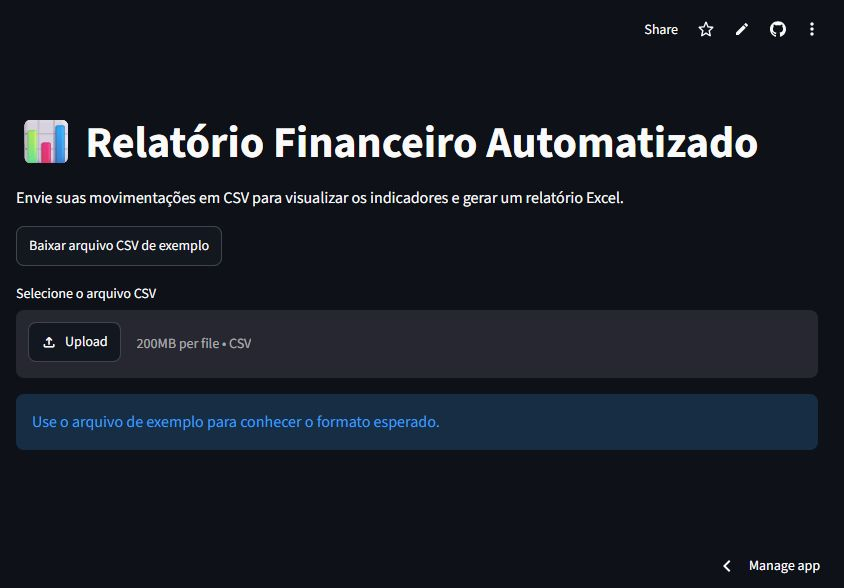

# Relatório Financeiro Automatizado com Python

Aplicação Python com interface web que transforma movimentações em CSV em indicadores, gráficos e um relatório Excel pronto para análise.

[](https://github.com/vbsouza1420/relatorio-financeiro-python/actions/workflows/tests.yml)
[](https://www.python.org/)
[](https://relatorio-financeiro-victor.streamlit.app/)

## Teste a aplicação

### [Abrir demonstração ao vivo](https://relatorio-financeiro-victor.streamlit.app/)

Não é necessário instalar Python. Baixe o CSV de exemplo na própria aplicação, envie o arquivo e gere o relatório Excel.

> Para preservar sua privacidade, utilize dados fictícios ou sem informações confidenciais na demonstração pública.



## Demonstração

A interface permite enviar um CSV, conferir os resultados no navegador e baixar o relatório sem utilizar comandos.

## Problema resolvido

Conferir receitas e despesas manualmente consome tempo e facilita erros. Este projeto automatiza a validação dos dados, calcula indicadores e cria uma planilha com abas organizadas.

## Funcionalidades

- valida datas, valores, tipos e categorias;
- identifica registros duplicados;
- calcula receitas, despesas e saldo;
- resume resultados por categoria e por mês;
- gera um arquivo Excel formatado;
- disponibiliza interface web com indicadores e gráficos;
- permite baixar um modelo CSV e o relatório final;
- inclui dados de exemplo e testes automatizados.

## Tecnologias

- Python 3.11+
- pandas
- openpyxl
- Streamlit
- pytest

## Executar a interface web

```bash
python -m venv .venv
.venv\Scripts\activate
pip install -r requirements.txt
streamlit run app.py
```

O navegador abrirá a aplicação em `http://localhost:8501`.

## Executar pela linha de comando

```bash
python -m venv .venv
.venv\Scripts\activate
pip install -r requirements.txt
python -m src.main exemplos/movimentacoes.csv -o saida/relatorio_financeiro.xlsx
```

No Linux ou macOS, ative o ambiente com `source .venv/bin/activate`.

## Formato do arquivo de entrada

O CSV deve usar as colunas abaixo:

| data | descricao | categoria | tipo | valor |
|---|---|---|---|---:|
| 2026-01-05 | Venda de serviço | Serviços | receita | 1500.00 |
| 2026-01-08 | Internet | Operacional | despesa | 120.90 |

O campo `tipo` aceita `receita` ou `despesa`. O valor deve ser positivo; o projeto aplica o sinal correto durante o processamento.

## Resultado

O arquivo gerado contém:

- **Resumo:** indicadores principais;
- **Movimentações:** dados tratados;
- **Por categoria:** totais agrupados;
- **Por mês:** evolução mensal.

## Testes

```bash
pytest
```

O GitHub Actions também executa os testes automaticamente a cada atualização.

## Possíveis evoluções

- importação de arquivos OFX;
- gráficos e comparações entre períodos;
- regras personalizadas por cliente.

## Autor

Desenvolvido por [Victor Souza](https://github.com/vbsouza1420) como projeto de portfólio Python focado em automação e dados.
